# Technical Report: Assignment 4
## Knowledge Distillation and Hardware-Aware Neural Architecture Search for Edge Devices

**Course:** Edge Computing & Intelligent Systems
**Hardware used:** AMD Ryzen 7 7700 (8C/16T) CPU · NVIDIA RTX 5060 Ti 16 GB · Windows 11
**Software:** Python 3.13 · PyTorch 2.10 (CUDA 12.8) · ONNX 1.23 · ONNX Runtime 1.31

Every number in this report was produced by the code in this folder. The raw values are in `outputs/results/*.csv`, `outputs/nas/*` and `outputs/logs/*`. The figures can be regenerated with `python -m report.make_figures`.

---

## Summary of results

| Model | Dataset | Params | ONNX size | CPU latency* | Peak mem | Top-1 |
|---|---|---|---|---|---|---|
| ResNet-50 teacher | CIFAR-100 | 23.71 M | 94.74 MB | 19.11 ms | 222.2 MB | **82.93 %** |
| MobileNetV2 baseline → **KD** | CIFAR-100 | 2.35 M | 9.38 MB | 1.56–1.79 ms | 32.2 MB | 75.27 → **78.79 %** (+3.52) |
| SqueezeNet baseline → **KD** | CIFAR-100 | 0.78 M | 3.11 MB | 1.05 ms | 15 MB | 72.88 → **76.00 %** (+3.12) |
| EfficientNet-Lite0 baseline → **KD** | CIFAR-100 | 3.50 M | 13.95 MB | 2.01 ms | 42.2 MB | 76.12 → **79.65 %** (+3.53) |
| **NAS-discovered net** | CIFAR-10 | **0.29 M** | **1.15 MB** | **0.89 ms** | **9.0 MB** | **92.49 %** |

\*ONNX Runtime, CPU, batch 1, 1 thread, median of 100 runs.

* **Distilled students:** all three improve by **+3.1 to +3.5 points**. They are **7–30× smaller** and **9.5–18× faster** than the teacher on CPU.
* **Best student:** distilled EfficientNet-Lite0 reaches 96% of the teacher's accuracy with 15% of its parameters.
* **NAS:** the evolutionary search sampled 93 architectures and rejected 26 of them on measured hardware limits. The architecture it found reaches 92.5% on CIFAR-10 with 0.29 M parameters and under 1 ms of single-core CPU latency.

---

# Part 1: Knowledge distillation (Question 1)

## 1.1 Data pipeline (`common/data.py`)
* **Data:** CIFAR-100 with 50 000 training and 10 000 test images, 32×32. The images are normalised with the per-channel CIFAR-100 mean and standard deviation.
* **Augmentation:** the standard CIFAR recipe. Each image is reflect-padded by 4 px, randomly cropped back to 32×32 and randomly flipped horizontally.
* **GPU-resident pipeline:** the full dataset is stored on the GPU as uint8 and augmented there in batches. This removes the Windows DataLoader bottleneck (see `dem.md`, Issue 1).
* **Training precision:** bf16 autocast with channels-last memory format. Evaluation and deployment are in fp32.

## 1.2 Teacher: ResNet-50 (`q1_kd/models/teacher_resnet50.py`, `q1_kd/train_teacher.py`)
* **Body:** the standard torchvision ResNet-50 bottleneck network, with the residual stages initialised from ImageNet (`IMAGENET1K_V2`).
* **CIFAR stem:** the 7×7/s2 conv + max-pool is replaced by a 3×3/s1 conv. The stage resolutions become 32 → 16 → 8 → 4, and the final feature map is 2048×4×4.
* **Training:** SGD with Nesterov momentum 0.9, lr 0.05, weight decay 5e-4 (none on BN/bias), 1 warm-up epoch then cosine decay, batch 128, 60 epochs.
* **Result:** **82.93% top-1 / 96.58% top-5** in fp32 (83.05% in the bf16 training log). Training took 47 min while another job shared the GPU.

## 1.3 Student architectures (implemented from scratch, `q1_kd/models/`)
All three students are written by hand, without torchvision model builders. All of them downsample 8×, so they end in a 4×4 feature map like the teacher.

| Student | Building block | CIFAR changes | Params | Final feature map |
|---|---|---|---|---|
| **MobileNetV2** | inverted residual: 1×1 expand (t=6) → 3×3 depthwise → linear 1×1 projection, skip if stride 1 | stem s1; stage-2 stride 2→1 | 2.35 M | 1280×4×4 |
| **SqueezeNet (v1.1 layout)** | Fire: 1×1 squeeze → parallel 1×1 + 3×3 expand, concatenated | 3×3/s1 stem, 3 max-pools, BN added (decision D3), conv classifier + GAP | 0.78 M | 512×4×4 |
| **EfficientNet-Lite0** | MBConv **without SE**, **ReLU6**, stochastic depth 0.1 | stem s1; stage-2 stride 2→1; B0 kernel/expansion table | 3.50 M | 1280×4×4 |

EfficientNet-Lite0 differs from B0 in three ways. It has no squeeze-and-excitation blocks and uses ReLU6 instead of Swish, both of which make it friendlier to quantisation and edge accelerators. Its stem (32 channels) and head (1280 channels) are also kept fixed.

## 1.4 Knowledge-distillation framework (`q1_kd/kd/distiller.py`)

```
L = (1-α)·CE(z_s, y)                              # hard labels
  +   α ·T²·KL( softmax(z_t/T) ‖ softmax(z_s/T) ) # soft targets with temperature
  +   β ·‖ n(r(f_s)) − n(f_t) ‖²                  # feature-based (FitNets hint)
```

| Required feature | Where it is implemented |
|---|---|
| Soft-target KD from teacher predictions | `soft_target_loss()`. The frozen teacher runs in eval mode under `no_grad` on the *same augmented batch* as the student. |
| Temperature-based softmax | `temperature_softmax(logits, T)`, T = 4. The T² factor keeps the gradient size the same for any T. |
| Combined hard + soft training | `(1-α)·CE + α·KD`, with α = 0.9. |
| Feature-based distillation | `FeatureHint`. A 1×1 conv + BN regressor maps the student's C_s channels to 2048. It is adaptively pooled to the teacher's spatial size if needed. The loss is the squared distance between L2-normalised features, bounded in [0, 4]. Hint pair: student last map ↔ teacher `layer4`. |

The regressor's parameters are optimised together with the student and are dropped after training, so the deployed student has no extra cost. `Distiller.train()` keeps the teacher in eval mode, which freezes its BN statistics.

## 1.5 Training protocol (baseline vs. KD)
Both pipelines share `q1_kd/trainer.py` and use **identical settings**:
* data, augmentation and seed (0)
* SGD Nesterov lr 0.1, weight decay 5e-4, batch 128, **100 epochs**, 1 warm-up epoch then cosine decay

The only difference is the loss. Baselines (`train_baseline.py`) use CE on the hard labels. KD students (`train_kd.py`) use the loss above. **The final-epoch weights are saved**, so the test set is never used to pick a checkpoint.

## 1.6 Results (fp32 evaluation on the 10 000-image CIFAR-100 test set, `outputs/results/kd_vs_baseline.csv`)

| Student | Baseline top-1 | KD soft+hard (β=0) | **KD soft+hard+feature** | Gain vs baseline | Baseline top-5 | KD top-5 |
|---|---|---|---|---|---|---|
| MobileNetV2 | 75.27 | 78.47 | **78.79** | **+3.52** | 94.35 | 95.52 |
| SqueezeNet | 72.88 | 75.86 | **76.00** | **+3.12** | 93.12 | 94.50 |
| EfficientNet-Lite0 | 76.12 | 79.08 | **79.65** | **+3.53** | 94.19 | 95.90 |
| *Teacher ResNet-50* | | | *82.93* | | | *96.58* |

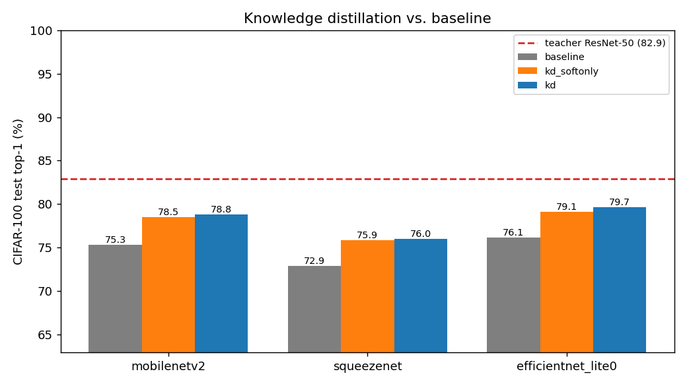
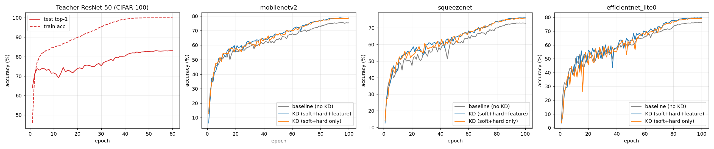

**Observations**
1. **KD helps every architecture by about 3–3.5 points of top-1 and 1.2–1.7 points of top-5.** KD closes 31–52% of the gap between each student and the teacher. For example, MobileNetV2's gap shrinks from 7.7 to 4.1 points.
2. **Ablation:** soft targets give most of the gain (+3.0 to +3.2). The feature hint adds a smaller but consistent +0.14 to +0.57 on all three students. The gain is largest for EfficientNet-Lite0, whose MBConv features are closest in form to the teacher's bottleneck features.
3. **Generalisation:** the training curves show the baselines overfitting (99.5% train accuracy against 75% test). The KD students end with higher test accuracy at a similar train accuracy. The teacher's soft labels act as a strong, data-dependent regulariser: they tell the student which mistakes are "reasonable", for example seal vs. otter.
4. **Small models gain the most relative to their size.** SqueezeNet (0.78 M parameters, 3.3% of the teacher) reaches 76.0%, which is better than the *baseline* MobileNetV2 with 3× more parameters.

## 1.7 Unified inference pipeline (`inference/`)
`inference/model_zoo.py` registers all eight models (teacher, 3 baselines, 3 KD students, NAS) with their checkpoint, ONNX path, dataset and input resolution. `inference/pipeline.py: EdgeClassifier` gives **one API for every model and two backends**:

```python
clf = EdgeClassifier("kd_squeezenet", backend="onnx")   # or backend="torch", device="cuda"
clf.predict_topk(images_uint8_nhwc, k=5)
clf.accuracy(images, labels)
```

Preprocessing (resize to the model's input size, normalisation with the dataset's statistics) is chosen automatically. `inference/predict.py` is the command-line front-end. It takes image files, ranges of CIFAR test images or full test-set evaluation, and accepts `--model all-students` to run every student in one call.

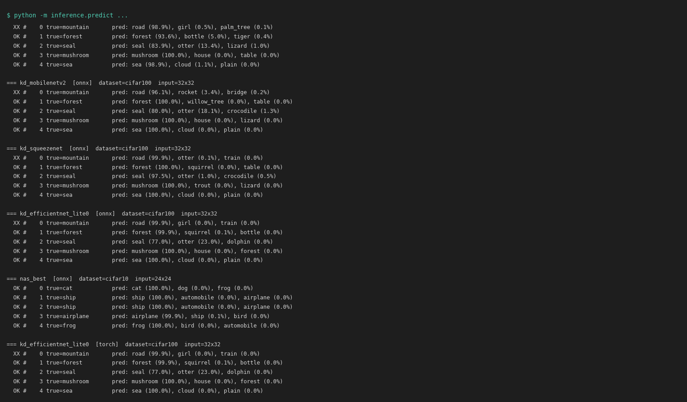

## 1.8 ONNX export and CPU inference (`deploy/`)
* `deploy/export_onnx.py` exports every model with opset 17 and a dynamic batch axis, as one self-contained `.onnx` file each. BN is folded into the convs by constant folding. Every export is checked in three ways:
  * the ONNX checker passes;
  * ONNX Runtime and PyTorch outputs differ by at most **≤ 1.1e-5** (max |Δlogit|) on random batch-8 inputs;
  * the arg-max predictions are identical.

  The log is in `outputs/logs/console_export.txt` and `outputs/results/onnx_export.csv`.
* `deploy/onnx_infer.py` is a **PyTorch-free** inference script (numpy + Pillow + onnxruntime). It reads the CIFAR test files directly and reproduces the PyTorch accuracies on CPU:

| ONNX model | ORT CPU accuracy | PyTorch fp32 accuracy | Throughput (4 threads, batch 256) |
|---|---|---|---|
| kd_mobilenetv2 | 78.76 % | 78.79 % | 1192 img/s |
| kd_squeezenet | 76.01 % | 76.00 % | 1504 img/s |
| kd_efficientnet_lite0 | 79.64 % | 79.65 % | 1107 img/s |
| nas_best | 92.48 % | 92.49 % | 1982 img/s |

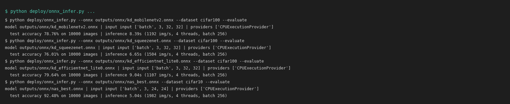

---

# Part 2: Hardware-aware Neural Architecture Search (Question 2)

## 2.1 Search space (`q2_nas/search_space.py`)
An architecture is a JSON dict. Its size is **≈ 3.1 × 10¹¹** distinct architectures.

| Dimension (required) | Choices |
|---|---|
| Variable input resolution | 24, 32, 40 px |
| Variable conv depth | 2, 3 or 4 stages × 1–3 blocks per stage (2–12 blocks) |
| Variable filters / channels | stem {16,24,32}; stage widths {16..48}, {32..96}, {64..160}, {128..256} |
| Kernel sizes | 3, 5, 7 (per stage) |
| Depthwise-separable blocks | block type ∈ {standard conv, **depthwise-separable**, MBConv (inverted residual, expansion 4)} |
| Activation functions | ReLU, ReLU6, Hard-Swish, SiLU (per stage) |

Stage 0 keeps the resolution, and every later stage starts with a stride-2 block. Residual connections are added automatically whenever the input and output shapes match.

## 2.2 Architecture generator (`q2_nas/generator.py`)
`build_from_config(arch)` builds a `GeneratedNet`: 3×3 stem → stages of `ConvBlock` / `DWSepBlock` / `MBConvBlock` → 1×1 head (256) → global average pool → dropout → linear. The config is stored inside every checkpoint, so `load_nas_checkpoint()` can rebuild the exact network.

## 2.3 Search strategy: Regularized (aging) evolution (`q2_nas/search.py`)
1. Fill a population of **16** with random *feasible*, trained architectures.
2. Repeat until **60** candidates have been trained:
   * draw a **tournament of 5** from the population and take the fittest as the parent;
   * make a child by **mutating** exactly one decision (resolution, stem, number of stages, or one of depth/width/kernel/block/activation of a random stage);
   * evaluate the child, add it to the population and **remove the oldest** member.

Ageing, rather than removing the worst member, keeps diversity and copes well with the noise of short proxy training (Real et al., 2019). Duplicate architectures are cached and never retrained.

## 2.4 Training and validation pipeline for candidates (`q2_nas/train_utils.py`)
* **Data split:** CIFAR-10 training set split 45 000 / 5 000 (seeded). Candidates are scored on the **held-out 5 000**, so the test set is never used during the search.
* **Proxy training:** 6 epochs, SGD lr 0.05, cosine schedule, batch 256, bf16. This takes about 35–45 s per candidate.
* **Resolution:** the loader resizes on the GPU to each candidate's input resolution.

## 2.5 Hardware-aware evaluation and constraints (`q2_nas/hardware.py`, `common/ort_probe.py`)
Before any training, each candidate is **exported to ONNX and measured on the real CPU**:

| Metric | How it is measured | Constraint |
|---|---|---|
| CPU inference latency | ONNX Runtime CPU EP, batch 1, **1 thread**, median of 50 runs after 10 warm-ups, in an isolated process. PyTorch CPU latency is also recorded. | **≤ 1.5 ms** |
| Model storage size | size of the exported fp32 `.onnx` file (state-dict size also recorded) | **≤ 2.0 MB** |
| Peak inference memory | fresh process: OS peak working set (Windows `peak_wset`) / `ru_maxrss` (Linux) minus the RSS before model load. Recorded as unsupported on other OSes. | **≤ 15 MB** |

A candidate that breaks any constraint is **rejected immediately** and costs no GPU time. Rejections are logged with their reasons. The constraint values come from profiling 15 random architectures (latency 0.27–7.4 ms, size 0.14–6.8 MB, memory 7–27 MB) and setting the limits in the middle of those ranges (see `decisions/README.md`, D9).

**Selection (fitness)** among feasible candidates is a MnasNet-style soft reward: `fitness = val_acc × (latency / 1.5 ms)^-0.03`. Between two equally accurate networks it prefers the faster one; for example, a network 2× faster gets about +2% relative fitness.

## 2.6 Search results (`outputs/nas/search_history.csv|json`, `best_arch.json`)
| | |
|---|---|
| Architectures sampled | 93 |
| Trained | 60 (16 random initial + 44 by mutation) |
| **Rejected by hardware constraints** | **26** (latency violations 17, size 17, memory 12; several broke more than one limit) |
| Duplicates (cache hits) | 7 |
| Search time | 42.3 min (with another training job on the GPU at the same time) |
| Mean proxy accuracy, random init → mutated children | 71.5 % → 77.5 % |

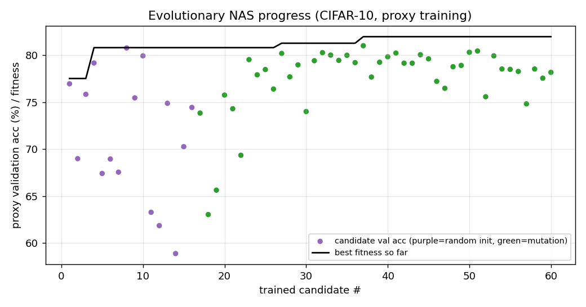
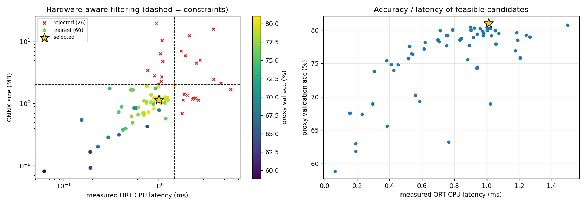

The left plot shows the *measured* latency and size of every sampled architecture. Red crosses fall outside the dashed constraint box and were never trained. The right plot shows the accuracy–latency trade-off among the feasible candidates. Accuracy saturates around 0.9–1.0 ms, and the search settles there.

**Top-5 architectures by fitness**

| id | proxy val | fitness | latency | ONNX | mem | architecture |
|---|---|---|---|---|---|---|
| **57** | **81.02** | **81.98** | 1.01 ms | 1.14 MB | 10.4 MB | `r24-s32 \| 2x32 k5 mbconv-relu \| 3x96 k7 mbconv-silu \| 1x128 k5 dwsep-relu` |
| 85 | 79.94 | 81.75 | 0.71 ms | 0.70 MB | 9.4 MB | `r24-s16 \| 2x32 k5 mbconv-relu \| 3x64 k7 mbconv-silu \| 1x128 k5 dwsep-relu` |
| 81 | 80.46 | 81.70 | 0.90 ms | 0.83 MB | 10.1 MB | `r24-s32 \| 2x48 k5 mbconv-relu \| 3x64 k7 mbconv-silu \| 1x128 k5 dwsep-relu` |
| 69 | 80.06 | 81.62 | 0.79 ms | 0.73 MB | 9.6 MB | `r24-s32 \| 2x32 k5 mbconv-relu \| 3x64 k7 mbconv-silu \| 1x128 k5 dwsep-relu` |
| 80 | 80.32 | 81.50 | 0.92 ms | 1.14 MB | 8.9 MB | `r24-s32 \| 2x32 k5 mbconv-relu \| 3x96 k7 mbconv-hswish \| 1x128 k5 dwsep-relu` |

**What the search learned:**
* **24 px input:** a lower resolution cuts latency roughly quadratically, which leaves the latency budget for more capacity.
* **Inverted-residual (MBConv) blocks with large 5×5/7×7 depthwise kernels:** a large receptive field is cheap with depthwise convolution.
* **A cheap depthwise-separable final stage.**

These are the same design rules found by hand in MobileNetV3 and EfficientNet.

## 2.7 Best architecture, retrained from scratch (`q2_nas/train_best.py`)
`search.py` writes `best_arch.json` automatically and then calls `train_best()`. This retrains the network from **fresh random weights** on the **full 50 000** training images for **100 epochs** and evaluates it on the 10 000 test images.

| | |
|---|---|
| Architecture | `r24-s32 | 2×MBConv(32,k5,ReLU) | 3×MBConv(96,k7,SiLU) | 1×DWSep(128,k5,ReLU)` |
| Parameters | 0.288 M |
| ONNX size / state-dict | 1.15 MB / 1.21 MB |
| ORT CPU latency (1 thread / 4 threads) | 0.89 ms / 0.34 ms |
| PyTorch CPU latency (1 thread) | 1.76 ms |
| Peak inference memory | 9.0 MB |
| Throughput (ORT, batch 64, 4 threads) | 2981 img/s |
| **CIFAR-10 test accuracy** | **92.49 %** (ONNX Runtime: 92.50 %) |
| Training time | 18.7 min |

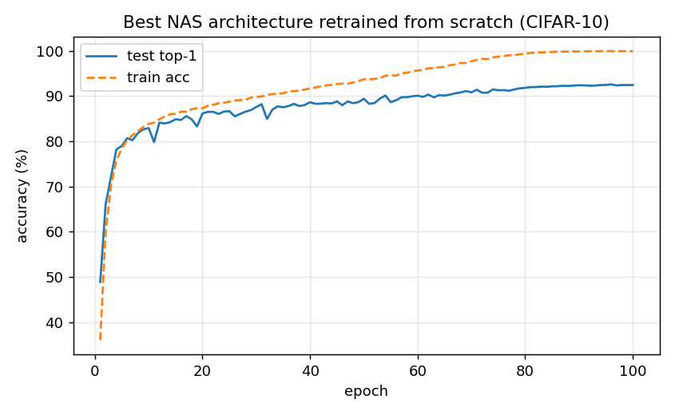

## 2.8 ONNX deployment of the NAS model
The checkpoint is exported by the same `deploy/export_onnx.py` (input `N×3×24×24`, max |Δ| = 6.7e-6) and runs through both the unified pipeline (`--model nas_best --backend onnx`) and the standalone `deploy/onnx_infer.py`. The standalone script resizes 32 → 24 with PIL and reaches the same accuracy (92.48%).

---

# Part 3: Automated benchmark (`benchmark/run_benchmark.py` → `outputs/results/benchmark.csv`)
The benchmark ran with no training jobs active. Latencies are batch-1 medians of 100 runs on the Ryzen 7 7700. Peak memory comes from the isolated ONNX Runtime process.

| Model | Params (M) | ONNX MB | Top-1 PyTorch | Top-1 ONNX | PyTorch CPU 1T (ms) | **ORT 1T (ms)** | ORT 4T (ms) | Peak mem (MB) | img/s (b64, 4T) |
|---|---|---|---|---|---|---|---|---|---|
| teacher_resnet50 | 23.705 | 94.74 | 82.93 | 82.96 | 32.61 | 19.11 | 5.98 | 222.2 | 197 |
| baseline_mobilenetv2 | 2.352 | 9.38 | 75.27 | 75.25 | 4.30 | 1.79 | 0.79 | 32.2 | 1445 |
| baseline_squeezenet | 0.777 | 3.11 | 72.88 | 72.86 | 2.27 | 1.05 | 0.46 | 15.2 | 1843 |
| baseline_efficientnet_lite0 | 3.499 | 13.95 | 76.12 | 76.11 | 4.89 | 2.03 | 0.76 | 42.1 | 1257 |
| kd_mobilenetv2 | 2.352 | 9.38 | **78.79** | 78.76 | 4.30 | 1.56 | 0.82 | 32.2 | 1486 |
| kd_squeezenet | 0.777 | 3.11 | **76.00** | 76.01 | 2.27 | 1.05 | 0.39 | 14.8 | 1897 |
| kd_efficientnet_lite0 | 3.499 | 13.95 | **79.65** | 79.64 | 5.09 | 2.01 | 0.77 | 42.2 | 1261 |
| nas_best (CIFAR-10) | 0.288 | 1.15 | 92.49 | 92.50 | 1.76 | 0.89 | 0.34 | 9.0 | 2981 |

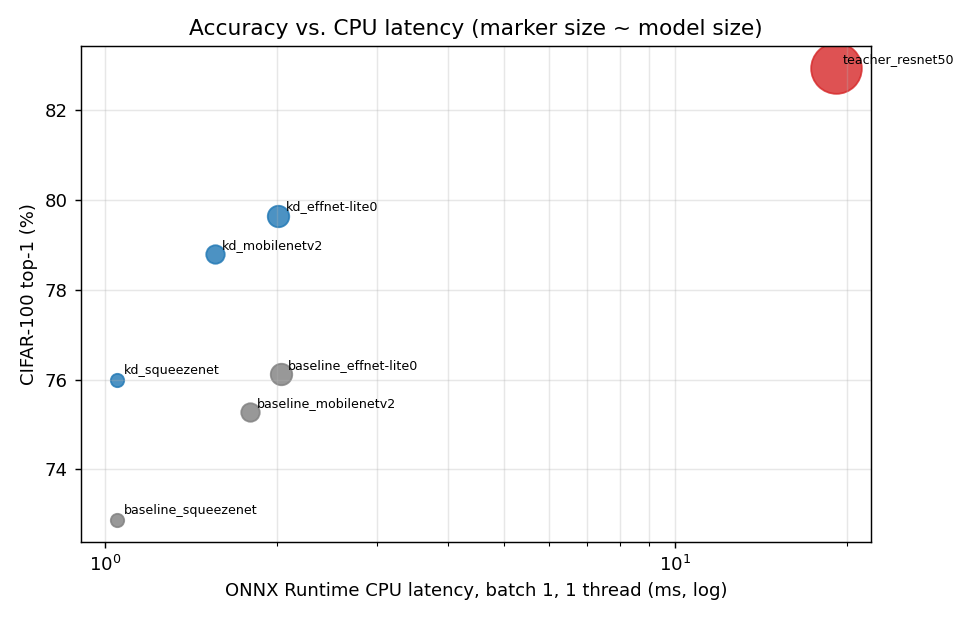

**Take-aways**
* **Students vs. teacher:**
  * EfficientNet-Lite0 (KD) is 6.8× smaller and 9.5× faster for −3.3 points.
  * MobileNetV2 (KD) is 10× smaller and 12× faster for −4.1 points.
  * SqueezeNet (KD) is 30× smaller and 18× faster for −6.9 points, with 15× less peak memory.
* **KD is free at inference time.** Baseline and KD versions of a student have the same architecture, so size, memory and latency are identical. Accuracy goes up by 3+ points.
* **ONNX Runtime is 1.7–2.8× faster than PyTorch eager** on CPU, thanks to graph optimisation, BN folding and fused kernels, with no change in accuracy (|Δacc| ≤ 0.03 points).
* **Measurement noise:** two runs of the same MobileNetV2 graph measured 1.56 and 1.79 ms, so latency differences under ~10% should not be read as real.
* **Memory:** the peak memory figures scale with weights plus activations. The teacher needs 222 MB, which already rules it out for many micro-controllers and small SBCs. The NAS model needs 9 MB.

---

# Part 4: Screenshots
The images below are renderings of the real console logs in `outputs/logs/` (`report/make_figures.py → console_screenshot`).

| | |
|---|---|
| Teacher training | 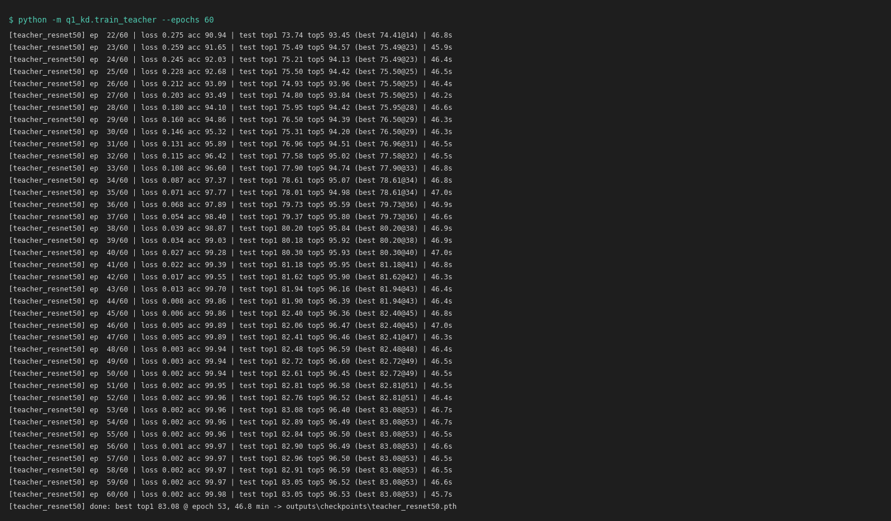 |
| Baseline training | 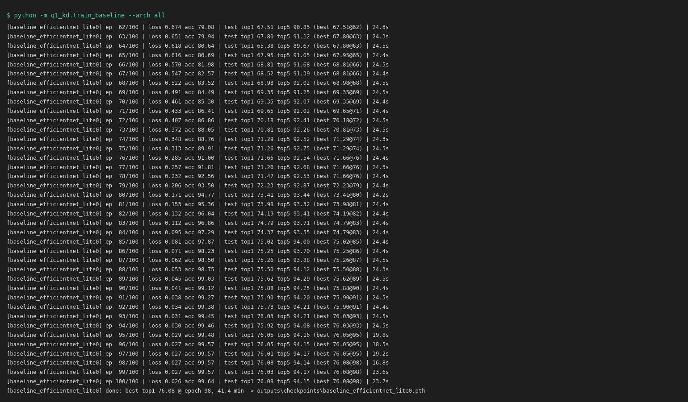 |
| KD training | 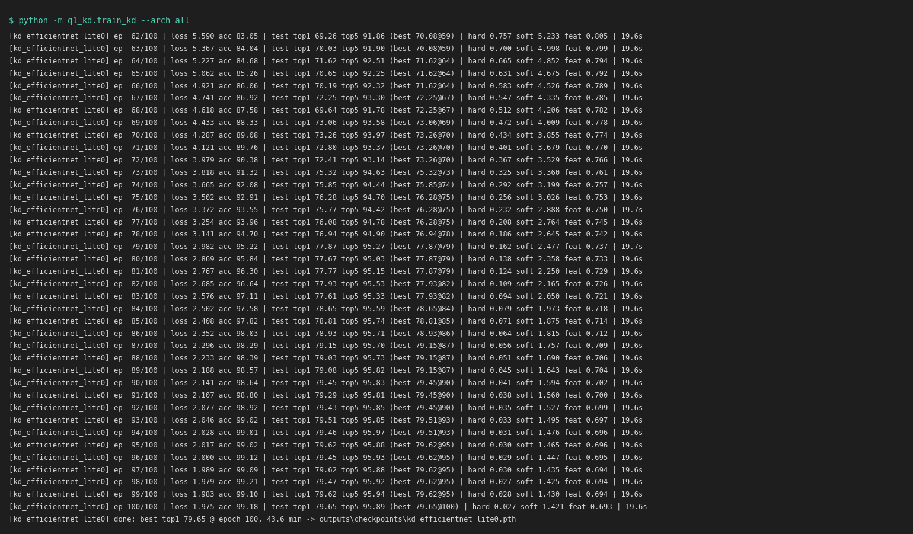 |
| NAS search (accept/reject log) | 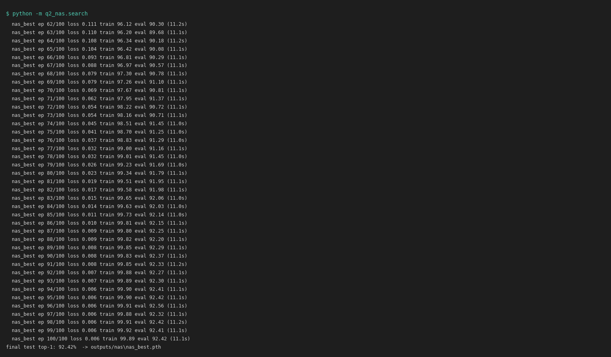 |
| ONNX export + verification | 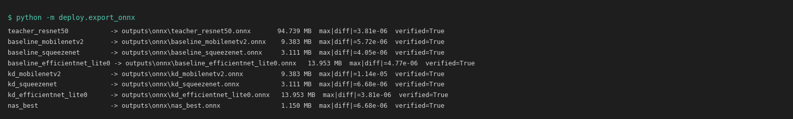 |
| Benchmark | 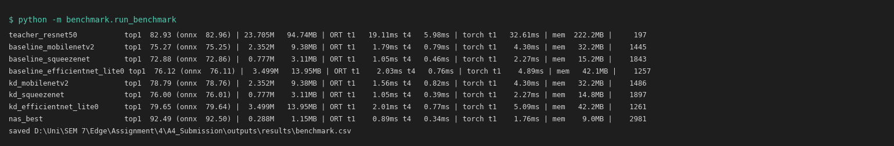 |
| Unified inference |  |
| Standalone ONNX Runtime |  |

---

# Part 5: Limitations and possible extensions
* **Single seed.** Each configuration was trained once (seed 0). The KD gains (+3.1 to +3.5) are much larger than typical seed variance on CIFAR-100 (~0.3 points). The +0.1 to +0.6 from the feature term is small enough that it should be confirmed with more seeds before drawing strong conclusions.
* **Pretrained teacher.** The teacher uses ImageNet initialisation (decision D1). A teacher trained from scratch would be weaker (about 78–79%) and would take 3–4× longer to train.
* **Proxy training noise in NAS.** Six proxy epochs rank architectures only approximately. Low-fidelity ranking is the usual NAS trade-off, and aging evolution is designed to tolerate it. The winner's ranking held up: it reached 92.5% after full training.
* **Latency is measured on a desktop CPU.** The pipeline is device-agnostic, so running `search.py` on the target device (for example a Raspberry Pi with `--threads 4`) would adapt the constraints to it directly.
* **Possible extensions:**
  * INT8 post-training quantisation of the ONNX models (`onnxruntime.quantization`), which would give about 4× smaller files;
  * distilling the NAS model;
  * multi-objective (Pareto) NAS.

## References
1. G. Hinton, O. Vinyals, J. Dean. *Distilling the Knowledge in a Neural Network*, 2015.
2. A. Romero et al. *FitNets: Hints for Thin Deep Nets*, ICLR 2015.
3. M. Sandler et al. *MobileNetV2: Inverted Residuals and Linear Bottlenecks*, CVPR 2018.
4. F. Iandola et al. *SqueezeNet: AlexNet-level accuracy with 50× fewer parameters and <0.5 MB model size*, 2016.
5. M. Tan, Q. Le. *EfficientNet*, ICML 2019; TensorFlow *EfficientNet-Lite* release, 2020.
6. E. Real et al. *Regularized Evolution for Image Classifier Architecture Search*, AAAI 2019.
7. M. Tan et al. *MnasNet: Platform-Aware Neural Architecture Search for Mobile*, CVPR 2019.
8. K. He et al. *Deep Residual Learning for Image Recognition*, CVPR 2016.
